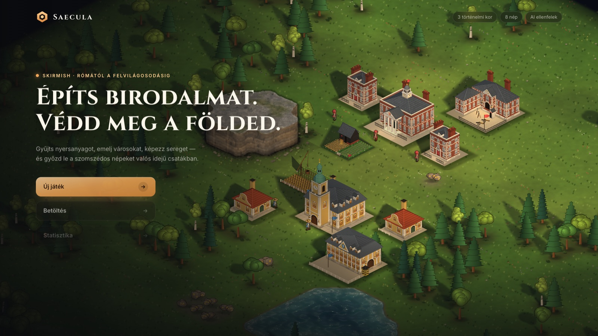
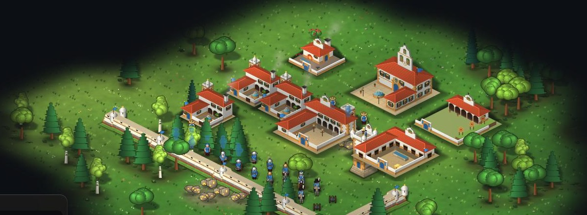
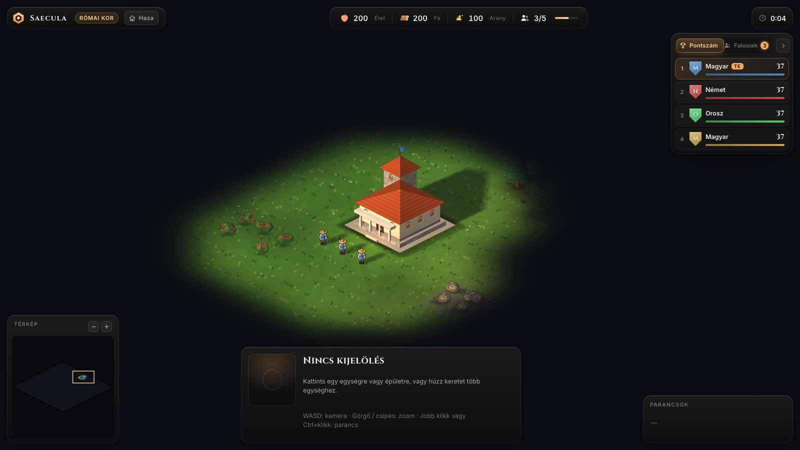
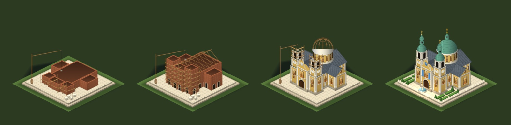

<div align="center">

# ⬢ Saecula

**An isometric historical real-time strategy game that runs in your browser.**
Three ages · eight nations · AI rivals — from Rome to the Enlightenment.

[](CHANGELOG.md)
[](https://github.com/ZoliQua/Saecula-Strategy-Game/actions/workflows/ci.yml)
[](LICENSE)


**English** · [Magyar](README.hu.md)



</div>

---

## About

*Saecula* (Latin: “ages, centuries”) is a single-player skirmish RTS in the
spirit of *Age of Empires II*, with a deliberately smaller scope. Pick a
nation, gather food, wood and gold, raise a town, train an army and lead your
people through three historical ages — while up to five AI rivals try to do
the same.

Everything you see and hear is **generated in code**: terrain, buildings,
units, lighting, sound effects and the adaptive music. There are no external
image or audio files.

The game's interface is in **Hungarian**; the code and the documentation are
in English and Hungarian.

## Features

- 🏛️ **Three ages** — Roman era, Middle Ages, Enlightenment. Each age brings
  new buildings and units, and every town visibly changes as it ages up.
- 🛡️ **Eight nations** — Hungarian, English, German, French, Spanish, Italian,
  Russian and Finnish. Each nation has its own architecture in each age, its
  own walls, unit gear and its own Wonder (Speyer, Versailles, the Alhambra,
  Florence, St Basil's, Petäjävesi…).
- ⚔️ **Ten unit types** — villagers, scouts, swordsmen, archers, knights,
  pikemen, crossbowmen, musketeers, cannons and cavalry.
- 🎖️ **Unique units and bonuses** — every nation replaces one base unit with
  its own (hussar, longbowman, landsknecht, mousquetaire, conquistador,
  legionary, cossack, sissi) and has a permanent bonus.
- 🤖 **AI rivals** — four difficulty levels (Easy to Master) and three
  personalities (rusher, economist, defender), with no cheating.
- 🗺️ **Five map types** — Meadow, Wilderness, Islands, Fortress and Random, in
  three sizes (64², 96², 128²) for 2–6 players.
- 🏆 **Two victory conditions** — Conquest, or holding a Wonder for ten minutes.
- 🌗 **Living world** — dynamic 2D lighting with normal maps, a day–night cycle,
  cast shadows, fog of war, construction and collapse animations.
- 🎵 **Procedural audio** — positional sound effects and generative music per
  age that grows more intense with the action on screen.
- 💾 **Save and load** — five slots plus an autosave every five game minutes,
  all stored locally (IndexedDB).
- 📊 **Scores and statistics** — a live scoreboard, a villager overview, a
  tech tree, and a match log with win rates, per-nation and per-difficulty
  breakdowns, and JSON export.
- ⌨️ **Configurable controls** — rebindable keys, trackpad support (two-finger
  pan, pinch zoom) and contextual cursors.

## Screenshots

| | |
|---|---|
|  |  |
| A Spanish town in the Enlightenment | The HUD with the live scoreboard |


<p align="center"><em>A Wonder rising through its construction stages</em></p>

## Quick start

You need [Node.js](https://nodejs.org/) 20 or newer.

```bash
git clone https://github.com/ZoliQua/Saecula-Strategy-Game.git
cd Saecula-Strategy-Game
npm install
npm run dev        # → http://localhost:5173
```

| Command | What it does |
|---|---|
| `npm run dev` | Development server with hot reload |
| `npm run build` | Type-check and production build into `dist/` |
| `npm run preview` | Serve the production build locally |
| `npm test` | Run the unit and simulation tests (Vitest) |
| `npm run lint` | ESLint |
| `npm run typecheck` | TypeScript, strict mode |

## How to play

| Action | Default control |
|---|---|
| Select | Left click, or drag a box |
| Command (move, gather, build, attack) | Right click, or Ctrl + left click |
| Move the camera | `W` `A` `S` `D`, arrow keys, screen edge, two-finger drag |
| Zoom | Mouse wheel, pinch, or the `+` / `−` buttons on the map |
| Jump to your town centre | `H`, or the “Haza” (Home) button |
| Scoreboard / villager panel | `Tab` / `V` |
| Tech tree | `T`, or the pause menu |
| Delete the selected building | `Delete` or `Backspace` |
| Pause menu | `Esc` |

All of these except `Esc` and the arrow keys can be changed under
**Beállítások → Irányítás** (Settings → Controls).

## Tech stack

| | |
|---|---|
| Engine | [Phaser 3](https://phaser.io/) (WebGL, Light2D) |
| Language | TypeScript (`strict`, `noUncheckedIndexedAccess`) |
| Build | Vite |
| Game state | [Miniplex](https://github.com/hmans/miniplex) ECS |
| UI state | Zustand (vanilla), DOM overlay UI |
| Pathfinding | `pathfinding` (A\*) |
| Storage and validation | localforage (IndexedDB), zod |
| Tests | Vitest |

The ECS world is the single source of truth for the game; Phaser objects only
render it. The full architecture, scope and conventions live in
[`CLAUDE.md`](CLAUDE.md) (in Hungarian).

## Project status and roadmap

Saecula is at version **0.3.0**. See the [changelog](CHANGELOG.md) for what
each version contains.

| Milestone | Content | Status |
|---|---|---|
| M0–M3 | Engine, economy, combat, AI, three ages | ✅ 0.1.0 |
| M4–M5 | Eight nations with their own architecture | ✅ 0.2.0 |
| M6 | Save/load, audio, Wonder victory, Master AI | ✅ 0.2.0 |
| M7 | Playtest fixes, controls, scores, statistics | ✅ 0.2.0 |
| M8 | Unique units and nation bonuses | ✅ 0.3.0 |
| Next | Shaped by playtesting | 🔜 |

Out of scope by design: multiplayer, mobile touch controls, campaigns.

## Documentation

- [`CHANGELOG.md`](CHANGELOG.md) — version history
- [`CONTRIBUTING.md`](CONTRIBUTING.md) — how to contribute
- [`CODE_OF_CONDUCT.md`](CODE_OF_CONDUCT.md) — community guidelines
- [`CONTRIBUTORS.md`](CONTRIBUTORS.md) — the people behind the game
- [`CLAUDE.md`](CLAUDE.md) — scope and architecture (Hungarian)
- [`PROGRAM_TERV.md`](PROGRAM_TERV.md) — the detailed development plan (Hungarian)

## Contributing

Bug reports, ideas and pull requests are welcome. Please read
[`CONTRIBUTING.md`](CONTRIBUTING.md) first, and follow the
[Code of Conduct](CODE_OF_CONDUCT.md).

## License

Saecula is released under the [MIT License](LICENSE) © 2026 Zoltán Dul.

The game loads the [Inter](https://rsms.me/inter/) and
[Cinzel](https://fonts.google.com/specimen/Cinzel) fonts from Google Fonts;
both are licensed under the SIL Open Font License 1.1.
